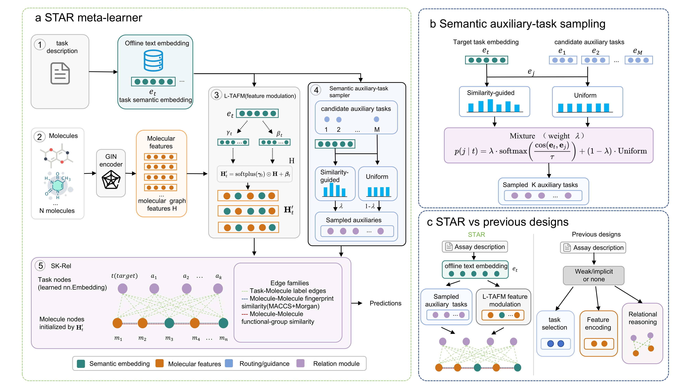

# STAR

**Structure and Text-Aware Relational meta-learning for few-shot molecular property prediction**

STAR is a few-shot molecular property prediction framework that augments a GS-Meta-style meta-learning backbone with assay-level language priors and explicit chemical-structure relations. The core idea is simple: public bioassays usually include short natural-language descriptions, and those descriptions contain useful task-level information about biological targets, readouts, and mechanisms. STAR encodes that text once and reuses it to guide task sampling and task-conditioned molecular feature modulation.

<p align="center">
  
</p>

## Highlights

- **Semantic auxiliary-task sampling**: samples biologically related training assays using text similarity between assay descriptions.
- **L-TAFM**: language-guided task-adaptive feature modulation that adjusts molecular features for each assay context.
- **SK-Rel / knowledge edges**: adds scaffold and functional-group similarity edges to strengthen chemical relational reasoning.
- **Few-shot meta-learning**: supports standard 1-shot and 10-shot molecular property prediction protocols.
- **Ablation-ready implementation**: scripts are included for baseline, individual modules, paired modules, and full STAR.

## Repository Structure

```text
STAR/
├── args_parser.py                  # Command-line arguments
├── run.py                          # Main training / evaluation entry
├── meta_learner.py                 # Episode-based meta-learning loop
├── semantic_utils.py               # Semantic encoder path and metadata helpers
├── dataset/                        # Dataset loading, molecular features, samplers
├── models/
│   ├── model.py                    # Molecular encoder / main model components
│   ├── semantic_sampler.py         # Text-guided task sampler
│   ├── ltafm.py                    # Language-guided feature modulation
│   ├── knowledge_edges.py          # Scaffold / functional-group relation edges
│   ├── krgts_relation.py           # Knowledge-enhanced relation backend
│   └── ...
├── scripts/
│   ├── precompute_property_embeddings.py
│   ├── ablation_study.sh
│   ├── run_ltafm.sh
│   └── ...
├── pretrained/
│   └── supervised_contextpred.pth  # Optional pretrained molecular encoder
├── figure/
│   └── overview.jpg
└── latex/                          # Manuscript source files
```

## Environment

The code follows the original GS-Meta software stack. A known working setup is:

```text
python           3.7
torch            1.7.1
torch_geometric  1.6.3
torch_scatter    2.0.7
learn2learn      0.1.6
rdkit            2022.9.3
scikit-learn
numpy
tqdm
tensorboard
```

Optional text encoders may require:

```text
transformers
sentence-transformers
```

The default semantic encoder is `tfidf`, which does not require downloading a neural language model.

## Data

Large dataset files are not tracked in this repository. Place benchmark data under:

```text
data/
```

The expected benchmark names include:

```text
tox21
sider
muv
pcba
toxcast-APR
toxcast-ATG
toxcast-BSK
toxcast-CEETOX
toxcast-CLD
toxcast-NVS
toxcast-OT
toxcast-Tanguay
toxcast-TOX21
```

This implementation builds on the GS-Meta data format. If starting from scratch, download the original GS-Meta data release, extract it into `data/`, and then add or generate the assay-description files required for semantic embeddings.

## Precompute Assay Text Embeddings

STAR uses precomputed property / assay-description embeddings. The default output paths are:

```text
data/embeddings/<dataset>/<dataset>_property_embeddings.pt
data/embeddings_bert/<dataset>/<dataset>_property_embeddings.pt
data/embeddings_sbert/<dataset>/<dataset>_property_embeddings.pt
```

Generate TF-IDF embeddings:

```bash
python scripts/precompute_property_embeddings.py --dataset tox21 --encoder tfidf
python scripts/precompute_property_embeddings.py --dataset sider --encoder tfidf
```

Generate embeddings for all supported datasets:

```bash
python scripts/precompute_property_embeddings.py --dataset all --encoder tfidf
```

## Running STAR

By default, `run.py` enables all three STAR modules:

```text
SK-Rel / knowledge edges: on
Semantic sampler: on
L-TAFM: on
```

So the standard full STAR run is:

```bash
python run.py --dataset tox21 --n_support 10 --gpu 0
```

For 1-shot:

```bash
python run.py --dataset tox21 --n_support 1 --gpu 0
```

To run the original GS-Meta-style baseline, disable the STAR modules explicitly:

```bash
python run.py --dataset tox21 --n_support 10 --gpu 0 \
  --relation_backend baseline \
  --use_knowledge_edges none \
  --use_semantic_sampler 0 \
  --use_ltafm 0
```

Use the pretrained molecular encoder:

```bash
python run.py \
  --dataset tox21 \
  --n_support 10 \
  --gpu 0 \
  --mol_pretrain_load_path pretrained/supervised_contextpred.pth
```

## Ablation Experiments

Run the full eight-way module ablation:

```bash
bash scripts/ablation_study.sh tox21 10 0
```

The ablation script evaluates:

```text
baseline
+ SK-Rel / KRGTS relation backend
+ semantic sampler
+ L-TAFM
+ paired module combinations
+ full STAR
```

Summarize finished runs:

```bash
python scripts/summarize_runs.py
python scripts/summarize_ablation_results.py
```

## Main Arguments

| Argument | Description |
| --- | --- |
| `--dataset` | Benchmark dataset name |
| `--n_support` | Number of support molecules per class, usually `1` or `10` |
| `--n_query` | Query molecules per episode |
| `--episode` | Number of meta-training episodes |
| `--relation_backend` | `baseline` or `krgts` |
| `--use_knowledge_edges` | `none`, `sca`, `gro`, or `both` |
| `--use_semantic_sampler` | Enable text-guided auxiliary task sampling |
| `--semantic_encoder` | `tfidf`, `bert`, or `sbert` |
| `--semantic_embedding_path` | Path to precomputed assay text embeddings |
| `--use_ltafm` | Enable language-guided task-adaptive feature modulation |
| `--mol_pretrain_load_path` | Optional pretrained molecular encoder checkpoint |

## Manuscript

The LaTeX manuscript source is under:

```text
latex/
```

The current formatted manuscript file is:

```text
latex/STAR_finally.tex
```

## Acknowledgement

This repository extends the GS-Meta codebase:

```bibtex
@inproceedings{zhuang2023graph,
  title={Graph Sampling-based Meta-Learning for Molecular Property Prediction},
  author={Zhuang, Xiang and Zhang, Qiang and Wu, Bin and Ding, Keyan and Fang, Yin and Chen, Huajun},
  booktitle={IJCAI},
  year={2023}
}
```

## Citation

If you use STAR, please cite the associated manuscript:

```bibtex
@article{star2026,
  title={Language priors from assay descriptions enable few-shot molecular property prediction},
  author={Zheng, Jiahao and Xiao, Yuanyuan and Li, Yuquan},
  year={2026},
  note={Manuscript in preparation}
}
```
